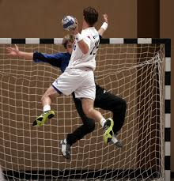

[← Volver al inicio](README.md)
# Temas del curso

### 14/09 · Mis aficiones

Llevo jugando al balonmano desde los ocho años, en el equipo
del pueblo. Lo que más me gusta no es marcar, es el momento
en que sale una jugada que habíamos entrenado veinte veces
y por fin sale. Entreno martes y jueves, y los sábados hay
partido. También llevo dos años tocando la guitarra, aunque
ahí voy mucho más lento: me sé cuatro canciones y media.

Buscando en GitHub he encontrado [Handball](https://github.com//evansloan/sports.py),
un programa libre para escribir temas de balonmano

### 13/10 · Ada Lovelace

Ada Lovelace (1815-1852) fue una matemática británica, hija del poeta Lord Byron. En 1843 tradujo un artículo sobre la máquina analítica de Charles Babbage y le añadió sus propias notas. En la Nota G describió paso a paso cómo calcular números de Bernoulli, y por eso se la considera la primera programadora. Cada segundo martes de octubre se celebra el Día de Ada Lovelace, para dar visibilidad a las mujeres en la ciencia y la tecnología.

